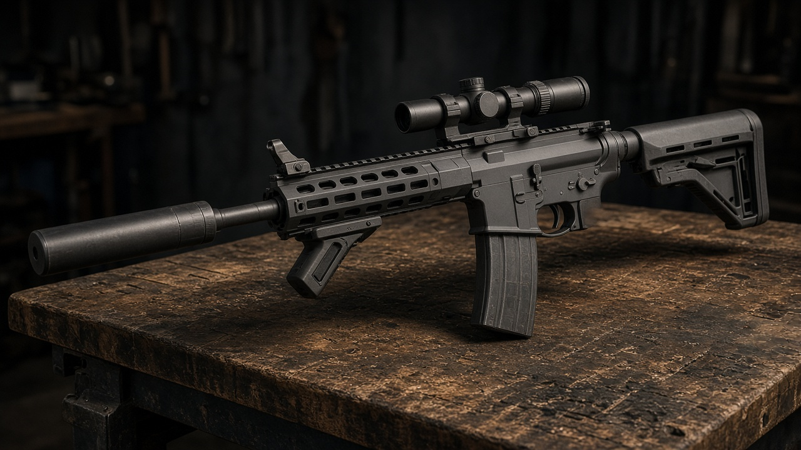
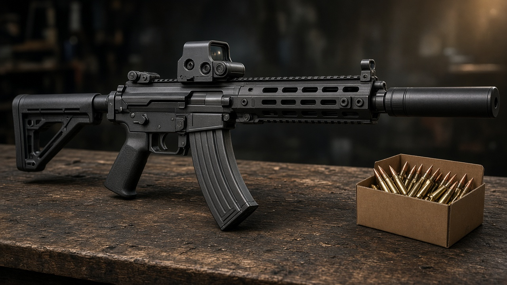
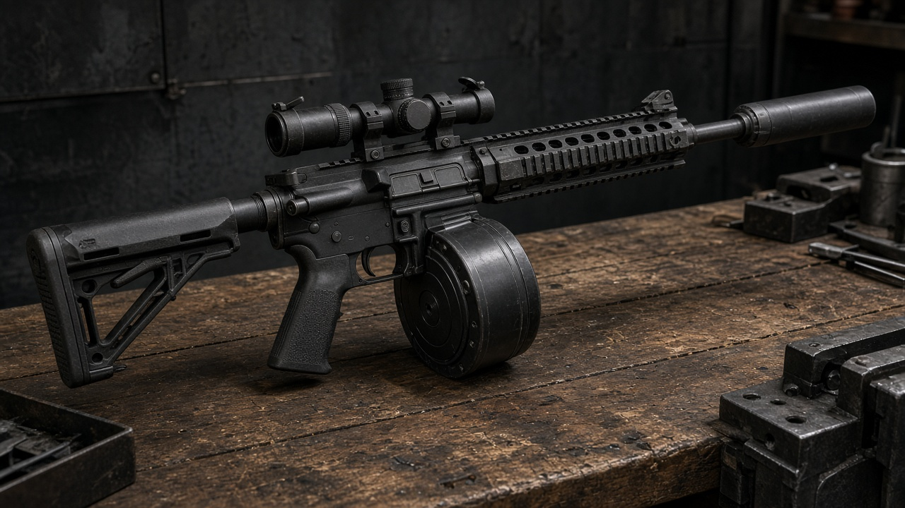
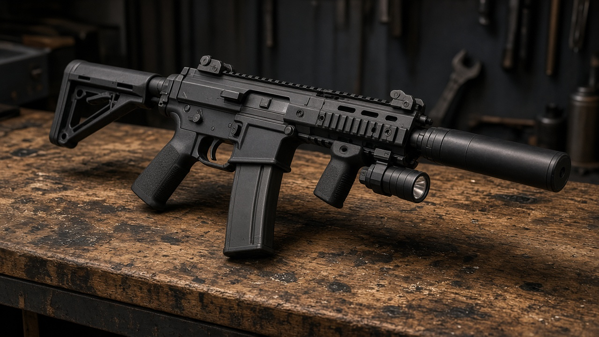
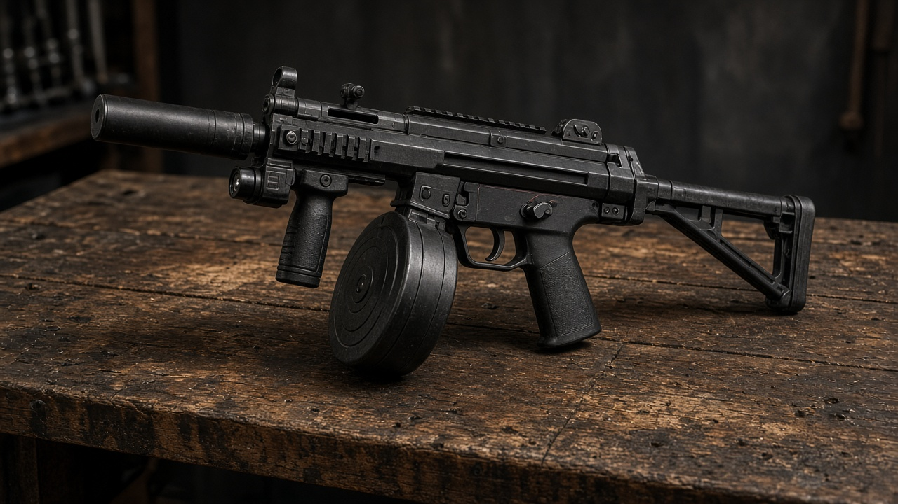
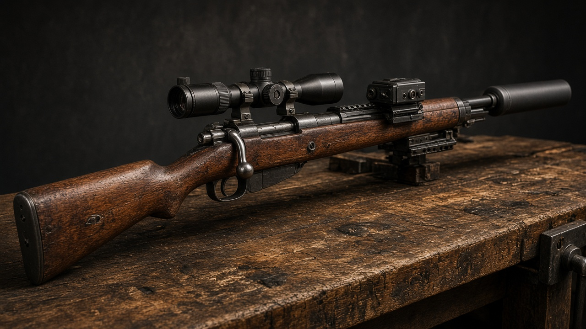

The Warzone Season 1 meta is only a week old, but the trackers already agree on a clear top end. As of **November 14, 2026**, [WZStats](https://wzstats.gg/) ranks the **Cronen Osprey** as the No. 1 long-range gun and the **ISO Nightshade** as the No. 1 close-range SMG, with the **Han 86** and **VEL 46** sitting just behind them. [2nd Shift's Nov 13 roundup](https://www.2ndshift.gg/best-warzone-loadouts/) had the same Osprey-and-Nightshade pairing on top after checking WZStats and MetaRadar.

This weekly guide covers six verified builds for Hajin and Zodiac: three long-range rifles, two SMGs, and the marksman option WZStats now lists as its No. 1 sniper. Every attachment below is taken from a current source. We do not invent stats, and we flag it when outlets disagree.

One important caveat: Infinity Ward's [November 13 Multiplayer patch](https://www.callofduty.com/patchnotes/2026/11/call-of-duty-modern-warfare-4-season-1-patch-notes) cut assault-rifle flinch by 25.4% and stretched the M4's max damage range by 26%, from 27.94 m to 35.31 m. [Timesaver notes](https://timesaver.gg/blog/mw4-november-13-weapon-buffs-flinch-m4-smg-range) that this tuning sits under the Multiplayer header, and Raven's [Warzone Season 1 notes](https://www.callofduty.com/patchnotes/2026/11/call-of-duty-mw4-warzone-season-1-patch-notes) still end at the [November 12 entry](/articles/warzone-no-aim-assist-through-smoke-nov-12-update-prestige-token-dmz-uav-fix/). Treat those range and flinch numbers as Multiplayer until Warzone posts its own tuning. The [hitscan and ballistics pass from earlier in the week](/articles/mw4-hitscan-range-3-91x-ballistics-34ms-faster-ranked-season-2/) does already apply in Warzone.

## Cronen Osprey (long range)

Season 1's new assault rifle is the long-range pick both [WZStats](https://wzstats.gg/) and [MetaRadar](https://metaradar.gg/warzone/meta) have at No. 1. [MetaRadar's current build](https://metaradar.gg/warzone/meta) (share code `A02-2TKF8-24ZCN-11`) is:

- **Optic:** Locus PX3 Canted (Rifle Scope)
- **Muzzle:** FSS IS300 (Heavy Silencer)
- **Barrel:** IO-556 Tac 18" (Long Barrel)
- **Underbarrel:** FSS Fireline Grip (Angled Grip)
- **Magazine:** 60 Round Mag

**Why it's meta:** it is the new Season 1 rifle and the No. 1 long-range weapon on the two trackers [2nd Shift checked on November 13](https://www.2ndshift.gg/best-warzone-loadouts/). The 18-inch barrel and heavy suppressor are built for Hajin's sightlines, and the 60-round mag covers more than one fight without a reload.

[GameRant's November 11 list](https://gamerant.com/call-of-duty-cod-warzone-best-meta-loadouts-weapon-builds-season-1-mw4/) keeps the same optic, muzzle and barrel, but swaps in a **100 Round Drum** and **5.56 NATO High Velocity** ammo instead of the grip and 60-round mag. [GameSpot](https://www.gamespot.com/articles/best-loadouts-in-call-of-duty-warzone-for-mw4-season-1/) also uses the IS300, Tac 18" barrel, Fireline Grip and 60-round mag, with a **Cronen R808 4x** if you prefer a dedicated mid-range scope. Pair the Osprey with the Nightshade or the VEL 46.

## Han 86 (long range)

The Han 86 is [WZStats' No. 2 long-range rifle](https://wzstats.gg/) and a META-tier option as of November 14. The long-range build that [MetaRadar (updated Nov 13)](https://metaradar.gg/warzone/weapons/han-86), [CODMunity](https://codmunity.gg/weapon/mw4/han-86) and [MW4 Intel (updated Nov 14)](https://mw4intel.app/loadouts/warzone-han-86) all list is the same, including the share code `A03-3KB4J-BPH2Q-FL11`:

- **Optic:** Cronen R808
- **Muzzle:** FSS IS300
- **Barrel:** Hanbit Lightning-7 465mm
- **Magazine:** 45 Round Mag
- **Ammunition:** 5.56 NATO High Velocity

**Why it's meta:** it is the second long-range rifle on WZStats, and the Lightning-7 barrel plus high-velocity ammo is the combination those trackers use to stretch its 5.56 rounds. The 45-round mag is the one in the newest share code.

[WZHUB's November 7 build](https://wzhub.gg/loadouts/mw4-han-86) uses the same optic, muzzle, barrel and ammo, but slots a **60 Round Drum** (code `A03-3KB4J-BPH2S-7U11`). [GameRant](https://gamerant.com/call-of-duty-cod-warzone-best-meta-loadouts-weapon-builds-season-1-mw4/) instead ran a Locus PX3 Canted, the Lightning-7, the IS300, a 60-round drum and high-velocity ammo. If you want more bullets between reloads, that drum swap is the documented alternative. GameRant pairs the Han 86 with the Nightshade for both Resurgence and Battle Royale.

## M4 (long range)

The M4 sits in A tier as [WZStats' No. 4 long-range assault rifle](https://wzstats.gg/). [GameRant's build](https://gamerant.com/call-of-duty-cod-warzone-best-meta-loadouts-weapon-builds-season-1-mw4/) is:

- **Barrel:** 18" LE Crosswind (Long Barrel)
- **Muzzle:** FSS IS300 (Heavy Silencer)
- **Magazine:** 60 Round Drum
- **Ammunition:** 5.56 NATO High Velocity
- **Optic:** Locus PX3 Canted (Rifle Scope)

**Why it's meta:** it is still a top-five long-range rifle on WZStats, and it is the gun that got the loudest attention in the [November 13 Multiplayer notes](/articles/mw4-nov-13-update-less-flinch-m4-range-joint-fire-5x-xp/) — a 26% max-range stretch, with damage values unchanged. Again, that figure is listed for Multiplayer, not yet in Warzone's notes, so try the long-range setup and see how it feels after the [hitscan change](/articles/mw4-hitscan-range-3-91x-ballistics-34ms-faster-ranked-season-2/).

[GameSpot](https://www.gamespot.com/articles/best-loadouts-in-call-of-duty-warzone-for-mw4-season-1/) prefers a **16" Highmark Barrel**, the **Cronen R808**, high-velocity ammo and a **45 Round Mag**, still with the FSS IS300. GameRant pairs the M4 with the Astaroth .57 if you want a dedicated sniper in the second slot.

## ISO Nightshade (close range)

The Nightshade is [WZStats' No. 1 close-range SMG](https://wzstats.gg/), and [2nd Shift](https://www.2ndshift.gg/best-warzone-loadouts/) had it in the same spot on MetaRadar as of November 13. [GameRant's build](https://gamerant.com/call-of-duty-cod-warzone-best-meta-loadouts-weapon-builds-season-1-mw4/), which 2nd Shift leads with, is:

- **Barrel:** ZLR Carbon-900 (Long Barrel)
- **Muzzle:** XRK Herder 40 (Tactical Silencer)
- **Underbarrel:** FSS Fireline Grip (Angled Grip)
- **Magazine:** 40 Round Mag
- **Laser:** Schlager Visiv-5 (Bright ADS Laser)

**Why it's meta:** both major trackers have it at No. 1 for closing out fights inside buildings, which is why it is the default pair for the Osprey and the Han 86. In Multiplayer, the [November 13 notes](https://www.callofduty.com/patchnotes/2026/11/call-of-duty-modern-warfare-4-season-1-patch-notes) also removed the Nightshade's final damage drop-off; like the M4 range change, that is not in Warzone's notes yet.

[MetaRadar](https://metaradar.gg/warzone/meta), [GameSpot](https://www.gamespot.com/articles/best-loadouts-in-call-of-duty-warzone-for-mw4-season-1/) and 2nd Shift's alternate all run a mobility-first version: **ZLR Mag-Z 9" barrel**, **40 Round Mag**, **Demo STP-1** rear grip, **EXP G2-44 Stock** and **9mm Parabellum High Velocity** (MetaRadar code `S06-3K9Y5-K39PZ-B911`). Use that if you want a faster-handling Nightshade.

## VEL 46 (close range)

The VEL 46 is [WZStats' No. 2 close-range SMG](https://wzstats.gg/) and carries a META tag there. [GameRant](https://gamerant.com/call-of-duty-cod-warzone-best-meta-loadouts-weapon-builds-season-1-mw4/) — which calls it "essentially the MP7" — builds it as:

- **Barrel:** VB-46 Series 11 (Long Barrel)
- **Muzzle:** XRK Herder 40 (Tactical Silencer)
- **Underbarrel:** FSS Fireline Grip (Angled Grip)
- **Magazine:** 60 Round Drum
- **Laser:** Schlager Visiv-5 (Bright ADS Laser)

**Why it's meta:** it is the clear second SMG on WZStats, and the 60-round drum is the reason [2nd Shift](https://www.2ndshift.gg/best-warzone-loadouts/) likes it for Zodiac's constant respawn fights. It is the usual swap if your long-range rifle is already paired with a Nightshade.

[MetaRadar](https://metaradar.gg/warzone/meta) and [DontLag](https://dontlag.com/games/call-of-duty-warzone/loadouts) use a velocity-focused variant: **TA TacPro-56**, **RV-B V2 Barrel**, **FSS Fireline Grip**, **EXP U-Turn Stock** and **4.6x30mm High Velocity** (MetaRadar code `S03-3K9Y5-L7T46-8711`). [GameSpot](https://www.gamespot.com/articles/best-loadouts-in-call-of-duty-warzone-for-mw4-season-1/) is close to that list, keeping the TacPro-56, a VB-46 Series 11 barrel, the Fireline Grip and high-velocity ammo, plus the **LM Combat Grip**. GameSpot also notes the VEL 46's **Snap** Apex attachment, which boosts swap speed and does not cost an attachment slot once the gun is maxed.

## Mosin-Nagant (marksman / sniper)

The Mosin-Nagant is [WZStats' No. 1 sniper/marksman](https://wzstats.gg/) as of November 14, and [2nd Shift](https://www.2ndshift.gg/best-warzone-loadouts/) had it as MetaRadar's No. 2 long-range pick a day earlier. [GameRant's build](https://gamerant.com/call-of-duty-cod-warzone-best-meta-loadouts-weapon-builds-season-1-mw4/) is:

- **Barrel:** Mosin 5025 Barrel (Long Barrel)
- **Muzzle:** FTAC Silent Recon (Heavy Silencer)
- **Ammunition:** 7.62x54mmr High Velocity
- **Optic:** VLK 1940-R 9x (Marksman Scope)
- **Laser:** Schlager Visiv-5 (Bright ADS Laser)

**Why it's meta:** it is the marksman option the trackers currently trust most, and GameRant describes it as a fast-handling rifle in the same role older Warzone players associate with a Kar98k. GameRant pairs it with the **X-58 NYX** for Resurgence; that SMG is A-tier close range (No. 5) on WZStats if you want a documented second gun for this slot.

[GameSpot](https://www.gamespot.com/articles/best-loadouts-in-call-of-duty-warzone-for-mw4-season-1/) and [MetaRadar](https://metaradar.gg/warzone/meta) still prefer the **KG-7 Vulcan** as their sniper recommendation. It is WZStats' No. 2 sniper, so it is the backup if the Mosin is not unlocked yet (GameRant's list has the Mosin arriving at a higher level than many of these ARs).

## Perks, lethals and tacticals

Season 1 loadouts use three base perk slots, plus one Elite perk you pick up in-match from a Buy Station or a Supply Run contract. You can only hold one Elite at a time.

[Dot Esports' best overall combination](https://dotesports.com/call-of-duty/guides/best-perks-mw4-warzone-season-1) is **Surveyor**, **Deft Hands**, **Berserker** and **Athleticism**. That is the balanced pick: intel, faster plating, better handling after fights, and sharper strafing and ADS movement. For a stealth route, Dot Esports uses Incognito with Phantom. For squads, it recommends Field Medic, Drill Instructor, Wingman and Fieldcraft.

[DontLag](https://dontlag.com/games/call-of-duty-warzone/loadouts) puts **Hunter**, **Adaptive**, **Tempered** and **Athleticism** on most of these same guns, swapping in Phantom on its sniper class. Either set is a documented starting point; Athleticism is the Elite both outlets favor for aggressive, close-range play.

On equipment, [WZStats' lethals list (updated Nov 13)](https://wzstats.gg/warzone-2/loadouts/best-lethals-tier-list) places **Semtex**, **Frag** and **Combat Axe** in its META tier. [DontLag](https://dontlag.com/games/call-of-duty-warzone/loadouts) pairs a Frag with a **Heartbeat Sensor** on its assault-rifle classes and a **Snapshot Grenade** on its SMGs. One Season 1 rule change matters here: since the [November 12 Warzone update](/articles/warzone-no-aim-assist-through-smoke-nov-12-update-prestige-token-dmz-uav-fix/), aim assist no longer works through Smoke Grenades or the Smoke Wall, even if shots open gaps in the cloud.

## What's next

Infinity Ward said it would watch the November 13 Multiplayer tuning over the [November 14–15 weekend](https://www.callofduty.com/patchnotes/2026/11/call-of-duty-modern-warfare-4-season-1-patch-notes) and expected more updates **next week**. The first thing we will look for is whether those range and flinch changes land in Warzone. This guide is an extra post, separate from the usual three daily news slots, and we will refresh it when the trackers move or Raven posts a weapon-tuning entry.

For the wider Season 1 picture, see our [Season 1 launch notes](/articles/warzone-season-1-live-hajin-zodiac-patch-notes-november-6/).
